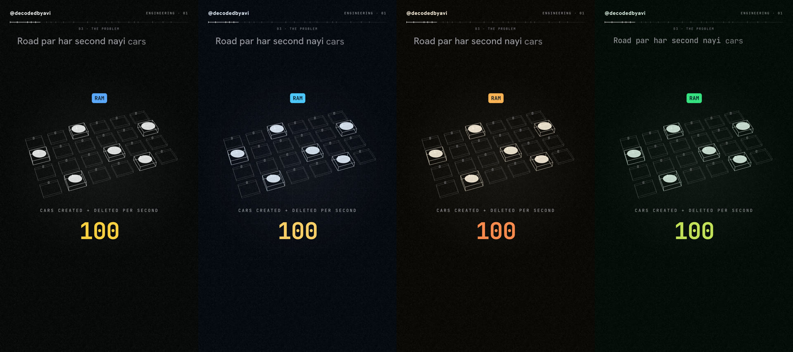

# make-explainer-animated-videos

**Turn a voice-over and a script into a premium dark-mode animated explainer video** (1080×1920 Reels / Shorts / TikTok), with a cleaned voice, a properly mixed music bed, sound effects, camera moves and transitions. 100% free and open source. No footage, no AI video, no paid tools. Everything is rendered from code, so every frame is deterministic and tweakable.

It is a [Claude Code](https://claude.com/claude-code) skill (an AI agent writes the storyboard and drives the scripts), but every step is also a plain script you can run and edit by hand.


*One storyboard, four looks (Mono Pulse, Blueprint, Amber Signal, Terminal Green).*

## What you get
- **The look:** near-black stage, a ~4k-particle hero that morphs between shapes and words, thin 3D wireframe diagrams with glowing active parts and travelling packets, word-synced captions with underlined key terms, a progress rail, rolling counters, stamps, a recap list, a comment-CTA bubble.
- **Voice first:** automatic cleanup of your recording (pauses capped, breaths and "ahh/umm" fillers removed, stretched vowels shortened, level-matched, speech chain), with an edit list that says what was removed and why.
- **Sound:** a music bed picked for groove, warmth and energy (techno / house / tech-house, not pop), SFX by role (whip, impact, pop, tick...), and a mix **solved from the stems**: voice 10-14 dB over music + SFX, never closer than 8 dB, -14 LUFS.
- **Energy:** camera snap/drift/punches, transitions only where the idea changes (each with its own sound), impact rings on reveals, a beat-locked glow, film grain, nothing static for more than 3 s.
- **Honesty gates:** invented numbers are labelled "simplified example" unless sourced; a safe-zone check for platform UI; QA that measures loudness, balance, pacing and layout.
- **Publish pack:** frame-0 headline, cover A/B, subtitles (.srt), a research-first posting kit with a linter, a LinkedIn post + 4:5 image, a publish checklist, and an upload script that **refuses to run without explicit approval flags**.
- **Languages:** English, or Roman-script Hinglish (and any language whisper can't read, via acoustic-island timing).

## Requirements
macOS or Linux (tested on macOS), **Node 22+**, **ffmpeg**, **Python 3.9+ with numpy**, **whisper.cpp** (`whisper-cli`) with an English model, a Chrome the renderer can use (downloaded automatically on first render). Optional: `librosa` (index your own music), `rclone` (upload), `yt-dlp` (study mode).

## Install
```bash
# as a Claude Code skill
git clone https://github.com/avijeetpandey/make-explainer-animated-videos ~/.claude/skills/make-explainer-animated-videos
bash ~/.claude/skills/make-explainer-animated-videos/scripts/setup.sh     # checks tools, downloads the whisper model, GSAP and fonts
```
Standalone (no Claude): clone anywhere and run the scripts in `scripts/` (see `docs/USAGE.md`).

## Quick start
1. Record your voice (one sentence per breath, ~0.3 s pauses between sentences, quiet room) and write the script.
2. Tell Claude: `/make-explainer-animated-videos` + the voice file path + the script. Claude writes `scenes.json`, builds, checks, renders a draft and shows you the contact sheets.
3. Or by hand: copy `examples/sample/scenes.json` to `~/Documents/explainer-videos/my_video/`, add `voice.wav`, edit the text, then:
```bash
S=~/.claude/skills/make-explainer-animated-videos/scripts
python3 -I $S/build_explainer.py ~/Documents/explainer-videos/my_video
cd ~/Documents/explainer-videos/my_video && npx --yes hyperframes@0.8.209 render -o renders/picture.mp4 -q delivery -f 30
bash $S/finalize.sh renders/picture.mp4 renders/my_video_final.mp4 assets/audio/master.wav
python3 -I $S/qa_explainer.py . renders/my_video_final.mp4
```
Full walkthrough with every command: [docs/USAGE.md](docs/USAGE.md).

## Make it yours
- **Handle, libraries, drive destination:** copy `config.example.json` to `config.local.json` and edit (git-ignored).
- **Music and SFX:** bring tracks you may legally use (see [library/README.md](library/README.md)) and index them with `scripts/build_music_index.py`. No library = no music (it tells you); no SFX library = a small synthesised set.
- **New look, shape, element, transition, language:** [docs/TWEAKING.md](docs/TWEAKING.md).
- **How it works:** [docs/ARCHITECTURE.md](docs/ARCHITECTURE.md). **Lessons learned:** [docs/LESSONS.md](docs/LESSONS.md). **Publishing method:** [references/PUBLISHING.md](references/PUBLISHING.md).

## Project layout
```
SKILL.md                 the agent's instructions (workflow, rules, options)
scripts/                 build_explainer.py (main), engine.js + explainer.css (the renderer), clean_voice.py, audio_lib.py, fx_plan.py,
                         mix_audio.py, qa_explainer.py, safe_zone_check.py, make_cover.py, make_srt.py, make_linkedin_image.py,
                         seo_research.py, kit_lint.py, publish_check.py, upload_drive.sh, build_music_index.py, make_sfx.py, setup.sh ...
assets/                  worlds.json (looks), fonts/ (OFL), posting-kit-template.md
references/              STAGE_LIBRARY.md (the storyboard format), STYLE_ANALYSIS.md, ENERGY_AND_SOUND.md, VOICE_CLEANUP.md, PUBLISHING.md, ROADMAP.md
examples/sample/         a working storyboard
tests/                   python3 -m unittest discover tests
```

## Honest limits
Wireframes are edges (no solid faces); one particle hero at a time; Canvas 2D, not WebGL; automatic filler detection only catches sustained sounds; Hinglish word timing inside fast stretches is +/-0.2-0.4 s (island starts are reliable; a hand-timed `words_override.json` always wins); the mix is judged by numbers, so listen once with headphones. The look was designed from an analysis of public explainer reels (see `references/STYLE_ANALYSIS.md`); **copy the format, never someone's brand or content.**

## Credits and licences
Code: MIT (see LICENSE). Renders HTML with [HyperFrames](https://github.com/heygen-com/hyperframes) (Apache-2.0); timing with [whisper.cpp](https://github.com/ggml-org/whisper.cpp) (MIT); GSAP as a timeline clock (GreenSock standard licence, not OSI); fonts under SIL OFL. Details: [NOTICE.md](NOTICE.md). Music and SFX are not included.

Built by [@avijeetpandey](https://github.com/avijeetpandey). Issues and pull requests welcome.
